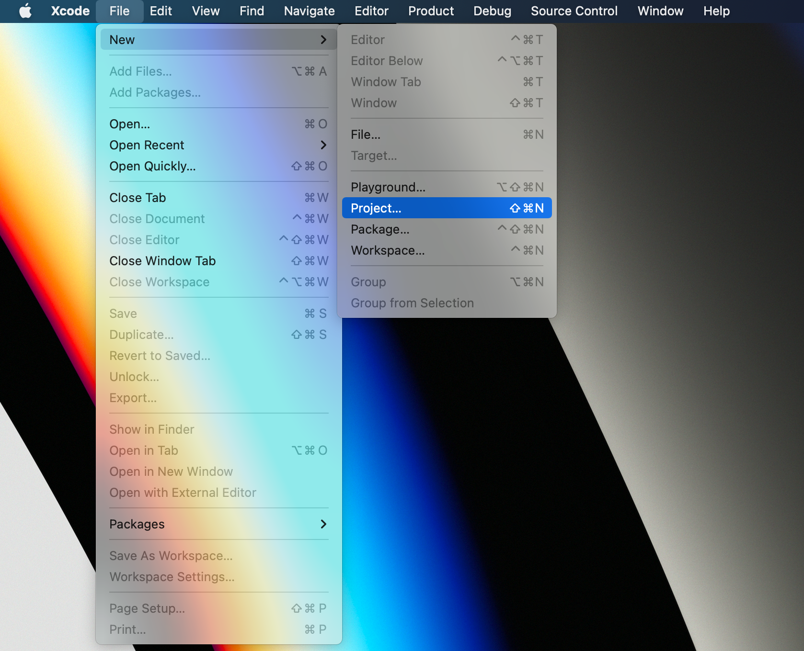
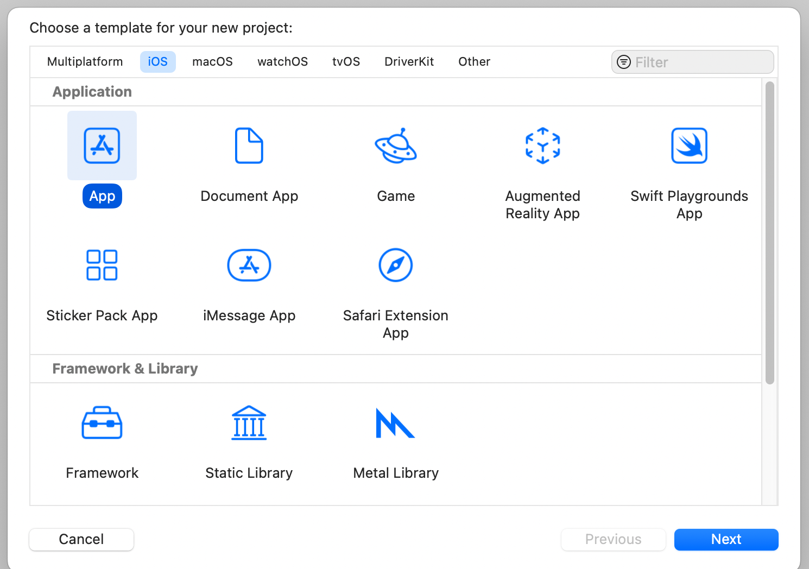
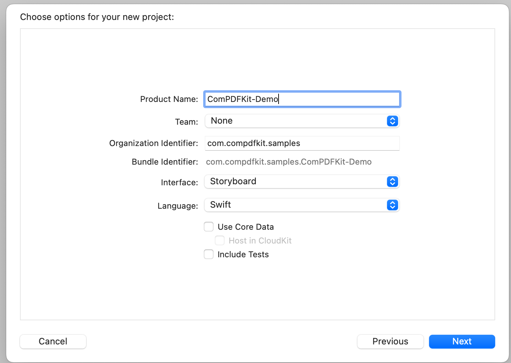
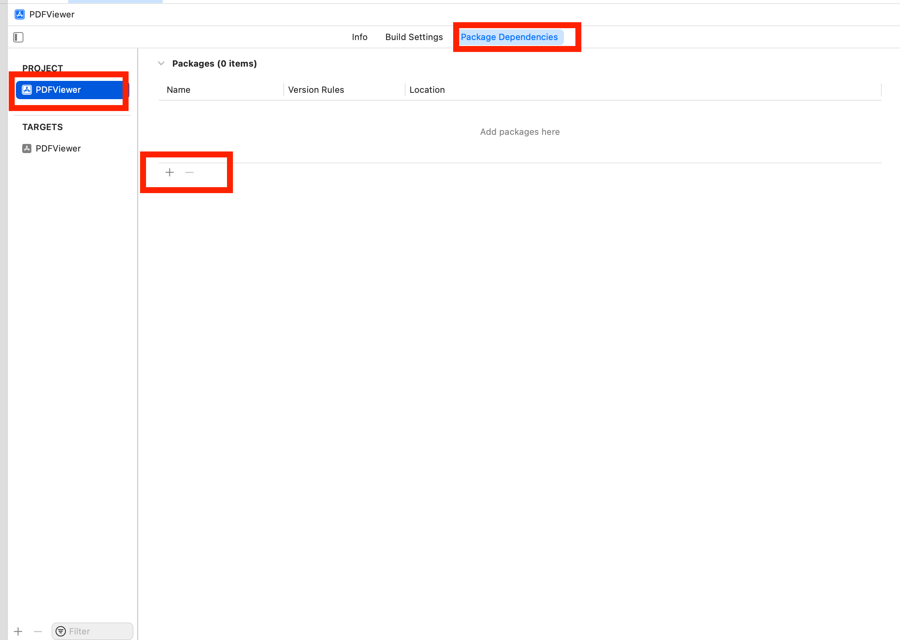
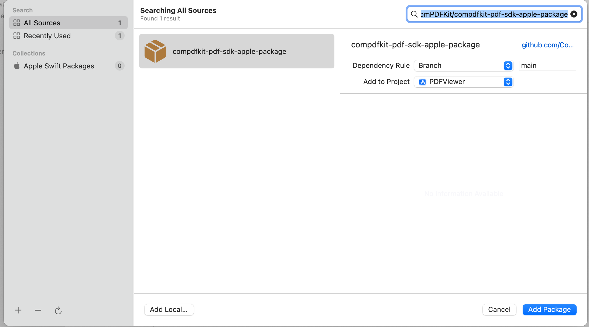
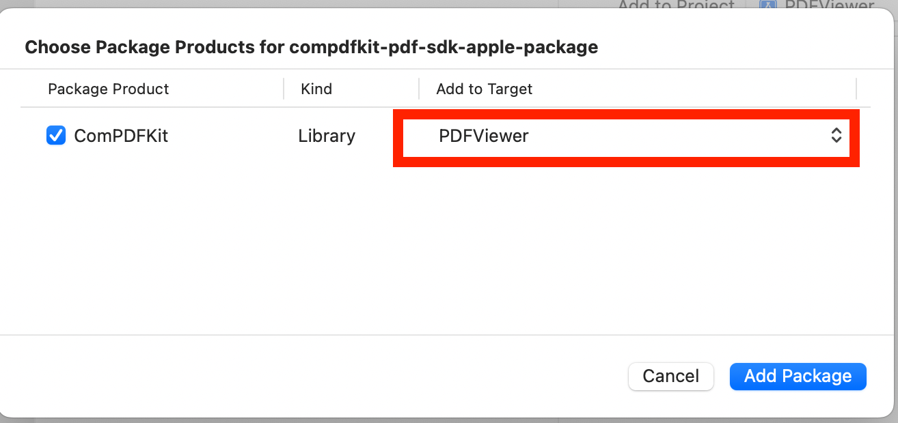
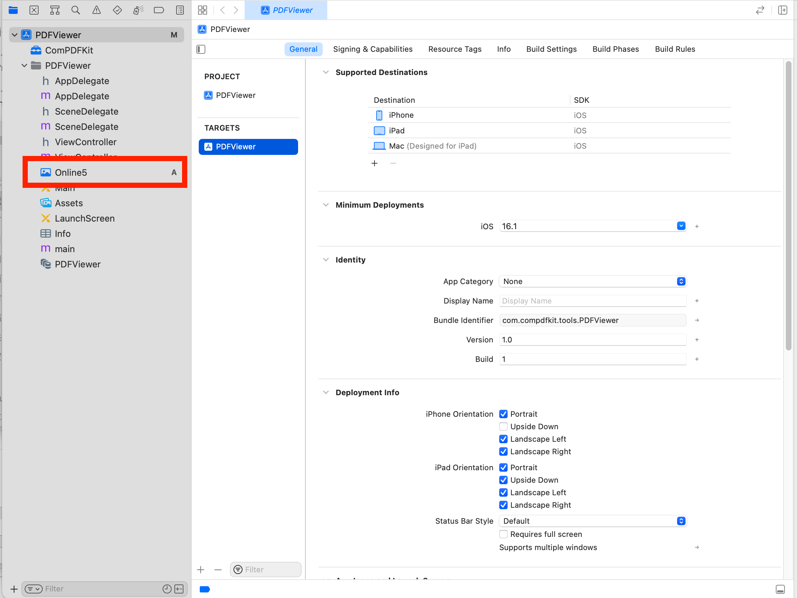
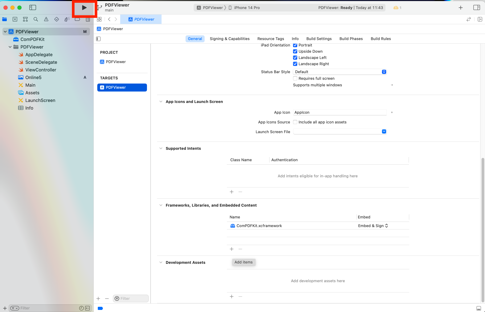
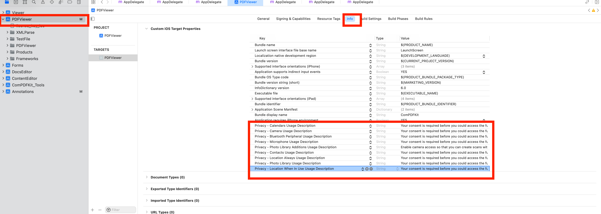

# ComPDF SDK for Apple (Swift Package Manager)

As part of the KDAN ecosystem, [ComPDF SDK for Apple](https://github.com/ComPDFKit/compdfkit-pdf-sdk-apple-package) helps you integrate the Swift-based ComPDF PDF Library into iOS applications through Swift Package Manager.

It provides a straightforward package-based distribution path for teams that want native iOS PDF capabilities without maintaining manual framework integration steps.

[ComPDF SDK](https://www.compdf.com/?utm_source=github&utm_medium=compdfkit-pdf-sdk-apple-package&utm_campaign=compdfkit_pdf_sdk_apple_package_repo&ref_platform_id=github_compdfkit) seamlessly operates on [Web](https://www.compdf.com/web?utm_source=github&utm_medium=compdfkit-pdf-sdk-apple-package&utm_campaign=compdfkit_pdf_sdk_apple_package_repo&ref_platform_id=github_compdfkit), [Windows](https://www.compdf.com/windows?utm_source=github&utm_medium=compdfkit-pdf-sdk-apple-package&utm_campaign=compdfkit_pdf_sdk_apple_package_repo&ref_platform_id=github_compdfkit), [Android](https://www.compdf.com/android?utm_source=github&utm_medium=compdfkit-pdf-sdk-apple-package&utm_campaign=compdfkit_pdf_sdk_apple_package_repo&ref_platform_id=github_compdfkit), [iOS](https://www.compdf.com/ios?utm_source=github&utm_medium=compdfkit-pdf-sdk-apple-package&utm_campaign=compdfkit_pdf_sdk_apple_package_repo&ref_platform_id=github_compdfkit), [Mac](https://www.compdf.com/contact-sales?utm_source=github&utm_medium=compdfkit-pdf-sdk-apple-package&utm_campaign=compdfkit_pdf_sdk_apple_package_repo&ref_platform_id=github_compdfkit), and [Server](https://www.compdf.com/server?utm_source=github&utm_medium=compdfkit-pdf-sdk-apple-package&utm_campaign=compdfkit_pdf_sdk_apple_package_repo&ref_platform_id=github_compdfkit), with support for cross-platform frameworks such as [React Native](https://www.compdf.com/react-native?utm_source=github&utm_medium=compdfkit-pdf-sdk-apple-package&utm_campaign=compdfkit_pdf_sdk_apple_package_repo&ref_platform_id=github_compdfkit), [Flutter](https://www.compdf.com/flutter?utm_source=github&utm_medium=compdfkit-pdf-sdk-apple-package&utm_campaign=compdfkit_pdf_sdk_apple_package_repo&ref_platform_id=github_compdfkit), etc.

If you find ComPDF SDK useful, please consider giving us a ⭐ **Star** on GitHub — it helps us grow and improve! Got questions or ideas? Join the conversation in our [Discussions](https://github.com/ComPDFKit/compdfkit-pdf-sdk-apple-package/discussions).

**Why ComPDF SDK Apple Package?**

* **Easy to Integrate:** Integrate PDF functionalities easily with our powerful SDK and clear documentation and guides with few lines of code.
  
* **Fully Customizable UI:** Design a unique interface for your products with fully customizable UI source code by a high-performing SDK.
  
* **[Comprehensive PDF Features:](https://www.compdf.com/pdf-sdk/features-list?utm_source=github&utm_medium=compdfkit-pdf-sdk-apple-package&utm_campaign=compdfkit_pdf_sdk_apple_package_repo&ref_platform_id=github_compdfkit)** Supports generation, viewing, annotation, page editing, content editing, conversion, OCR, redaction, signing, forms, parsing, measurement, compression, comparison, color separation, batch processing, and more.
  
* **Faster Time-to-Market:** Comprehensive SDK libraries save your time and expenses and roll out your applications and projects.
  
* **High-quality Service:** We provide 24/7 professional one-to-one technical support, including onsite service and remote assistance via phone and email.
  

## Table of Contents

* [Related](#related)
* [Requirements](#requirements)
* [Apply the License Key](#apply-the-license-key)
* [How to Make an iOS PDF Editor with Swift Package Manager](#how-to-make-an-ios-pdf-editor-with-swift-package-manager)
* [Add Required Permissions](#add-required-permissions)
* [Changelog](#changelog)
* [Free Trial and License](#free-trial-and-license)
* [Support](#support)

## Related

* [ComPDF PDF Library for iOS (Objective-C)](https://github.com/ComPDFKit/compdfkit-pdf-sdk-ios-objective-c)
* [ComPDF PDF Library for Android](https://github.com/ComPDFKit/compdfkit-pdf-sdk-android)
* ComPDF SDK - [Flutter Library](https://pub.dev/packages/compdfkit_flutter)
* ComPDF SDK - [React Native Library](https://github.com/ComPDFKit/compdfkit-pdf-sdk-react-native)
* [How to Build an iOS PDF Viewer or Editor in Swift](https://www.compdf.com/blog/build-an-ios-pdf-viewer-or-editor-in-swift?utm_source=github&utm_medium=compdfkit-pdf-sdk-apple-package&utm_campaign=compdfkit_pdf_sdk_apple_package_repo&ref_platform_id=github_compdfkit)
* [How to Build an iOS PDF Viewer or Editor in Objective-C](https://www.compdf.com/blog/build-an-ios-pdf-viewer-or-editor-in-objective-c?utm_source=github&utm_medium=compdfkit-pdf-sdk-apple-package&utm_campaign=compdfkit_pdf_sdk_apple_package_repo&ref_platform_id=github_compdfkit)

## Requirements

[ComPDF SDK for Swift](https://www.compdf.com/guides/pdf-sdk/ios/overview?utm_source=github&utm_medium=compdfkit-pdf-sdk-apple-package&utm_campaign=compdfkit_pdf_sdk_apple_package_repo&ref_platform_id=github_compdfkit) requires the latest stable version of Xcode available at the time the release was made. This is a hard requirement, as each version of Xcode is bundled with a specific version of the iOS Base SDK, which often defines how UIKit and various other frameworks behave.

* The iOS 10.0 or higher.
* The [Xcode](https://developer.apple.com/xcode/) 13.0 or newer for Objective-C or Swift.

## Apply the License Key

ComPDF SDK for Apple supports flexible licensing options, including online and offline licenses. You can apply for a [free trial license](https://www.compdf.com/pricing?utm_source=github&utm_medium=compdfkit-pdf-sdk-apple-package&utm_campaign=compdfkit_pdf_sdk_apple_package_repo&ref_platform_id=github_compdfkit) on our website or contact [our sales team](mailto:support@compdf.com) to get the offline license. Each license is only valid for a root domain name and any of its subdomains. However, any documents, sample code, or source code distribution from the released package of ComPDF SDK to any third party is prohibited.

To learn how to [copy and apply the license key](https://www.compdf.com/guides/pdf-sdk/ios/apply-the-license-key?utm_source=github&utm_medium=compdfkit-pdf-sdk-apple-package&utm_campaign=compdfkit_pdf_sdk_apple_package_repo&ref_platform_id=github_compdfkit) and more details about our license, please visit our comprehensive documentation.


## How to Make an iOS PDF Editor with Swift Package Manager
It's easy to embed ComPDF into an iOS application with a few lines of Swift or Objective-C code. Take a few minutes to get started.

The following sections explain how to run integration with Swift Package into your project


## Creating a New Xcode Project

1. Open Xcode and select **File** > **New** > **Project…** to create a new project for your application:

   

2. Choose the **App** template for your project:

   

3. When prompted, enter your app name (ComPDFKit-Demo) and your organization identifier (com.example) and choose **Storyboard** for the interface:

   

4. Click **Next** and select the location to save the project.

5. Click **Create** to finish.

   

## Integrate ComPDFKit Apple Package into SPM

1. Open your application in Xcode and select your project’s **Package Dependencies** tab.

   

2. Copy the [ComPDFKit Apple package](https://github.com/ComPDFKit/compdfkit-pdf-sdk-apple-package) repository URL into the search field:

   ```shell
   https://github.com/ComPDFKit/compdfkit-pdf-sdk-apple-package
   ```

   

3. In the **Dependency Rule** fields, select **Branch** > **master**, and then click **Add Package**.



4. After the package download completes, select **Add Package**.


5. ComPDFKit should now be listed under Swift Package Dependencies in the Xcode Project navigator.


## Display a PDF Document

So far, we have added ***"ComPDFKit.xcframework"*** to the ***"PDFViewer"*** project, and finished the initialization of the ComPDFKit PDF SDK. Now, let’s start building a simple PDF viewer with just a few lines of code.

1. Prepare a test PDF file, drag and drop it into the newly created **PDFView** project. By this way, you can load and preview the local PDF document using `NSBundle`. The following image shows an example of importing a PDF document named `Online5` into the project.

   

   

2. Create a `CPDFDocument` object through **NSURL**, and create a `CPDFView` to display it. The following code shows how to load PDF data using a local PDF path and display it by `CPDFView`.

   ```swift
   guard let filePath = Bundle.main.path(forResource: "Online5", ofType: "pdf") else { return  }
   let url = URL(fileURLWithPath: filePath)
   let document = CPDFDocument(url: url)
   
   let rect = self.view.bounds
   let pdfView = CPDFView(frame: self.view.bounds)
   pdfView.autoresizingMask = [.flexibleWidth, .flexibleHeight]
   pdfView.document = document
   ```

3. Add the created `CPDFView` to the view of the current controller. The sample code shows below.

   ```swift
   self.view.addSubview(pdfView)
   ```

   The code shown here is a collection of the steps mentioned above:

   ```swift
   override func viewWillAppear(_ animated: Bool) {
        super.viewWillAppear(animated)
           
        guard let filePath = Bundle.main.path(forResource: "Online5", ofType: "pdf") else { return  }
        let url = URL(fileURLWithPath: filePath)
        let document = CPDFDocument(url: url)
   
        let rect = self.view.bounds
        let pdfView = CPDFView(frame: self.view.bounds)
        pdfView.autoresizingMask = [.flexibleWidth, .flexibleHeight]
        pdfView.document = document
        self.view.addSubview(pdfView)
   }
   ```

4. Connect your device or simulator, and use shortcut **Command_R** to run the App. The PDF file will be opened and displayed.

   


## Add Required Permissions

To protect user privacy, before accessing the sensitive privacy data, you need to find the "***Info***" configuration in your iOS 10.0 or higher iOS project and configure the relevant privacy terms as shown in the following picture.



```objective-c
<key>NSCameraUsageDescription</key>
<string>Your consent is required before you could access the function.</string>

<key>NSMicrophoneUsageDescription</key>
<string>Your consent is required before you could access the function.</string>

<key>NSPhotoLibraryAddUsageDescription</key>
<string>Your consent is required before you could access the function.</string>

<key>NSPhotoLibraryUsageDescription</key>
<string>Your consent is required before you could access the function.</string>
```

## Changelog

Keep up with the latest updates, improvements, and bug fixes for ComPDF SDK for iOS: [View iOS Changelog](https://www.compdf.com/pdf-sdk/changelog-ios?utm_source=github&utm_medium=compdfkit-pdf-sdk-apple-package&utm_campaign=compdfkit_pdf_sdk_apple_package_repo&ref_platform_id=github_compdfkit).

## Free Trial and License

[ComPDF SDK](https://www.compdf.com/?utm_source=github&utm_medium=compdfkit-pdf-sdk-apple-package&utm_campaign=compdfkit_pdf_sdk_apple_package_repo&ref_platform_id=github_compdfkit) offers a **30-day free trial** so you can evaluate core PDF capabilities in your own application.

To get started:

1. Apply for a [free trial](https://www.compdf.com/pricing?utm_source=github&utm_medium=compdfkit-pdf-sdk-apple-package&utm_campaign=compdfkit_pdf_sdk_apple_package_repo&ref_platform_id=github_compdfkit)
2. Review supported trial features and licensing details
3. Follow the integration and [license steps](https://www.compdf.com/guides/pdf-sdk/ios/apply-the-license-key?utm_source=github&utm_medium=compdfkit-pdf-sdk-apple-package&utm_campaign=compdfkit_pdf_sdk_apple_package_repo&ref_platform_id=github_compdfkit) to activate the SDK in your project

For custom deployments, advanced features, or volume licensing, please [contact our sales team](https://www.compdf.com/contact-sales?utm_source=github&utm_medium=compdfkit-pdf-sdk-apple-package&utm_campaign=compdfkit_pdf_sdk_apple_package_repo&ref_platform_id=github_compdfkit)

## Support

[ComPDF](https://www.compdf.com/?utm_source=github&utm_medium=compdfkit-pdf-sdk-apple-package&utm_campaign=compdfkit_pdf_sdk_apple_package_repo&ref_platform_id=github_compdfkit) has a professional R&D team that produces comprehensive technical documentation and guides to help developers. Also, you can get an immediate response when reporting your problems to our support team.

* For detailed information, please visit our [Guides](https://www.compdf.com/guides/pdf-sdk/ios/overview?utm_source=github&utm_medium=compdfkit-pdf-sdk-apple-package&utm_campaign=compdfkit_pdf_sdk_apple_package_repo&ref_platform_id=github_compdfkit) page.
* For technical assistance, please reach out to our [Technical Support](https://www.compdf.com/support?utm_source=github&utm_medium=compdfkit-pdf-sdk-apple-package&utm_campaign=compdfkit_pdf_sdk_apple_package_repo&ref_platform_id=github_compdfkit).
* To get more details and an accurate quote, please contact our [Sales Team](https://www.compdf.com/contact-sales?utm_source=github&utm_medium=compdfkit-pdf-sdk-apple-package&utm_campaign=compdfkit_pdf_sdk_apple_package_repo&ref_platform_id=github_compdfkit) or [send an email](mailto:support@compdf.com).
